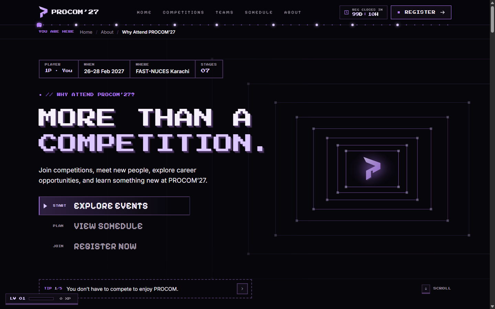
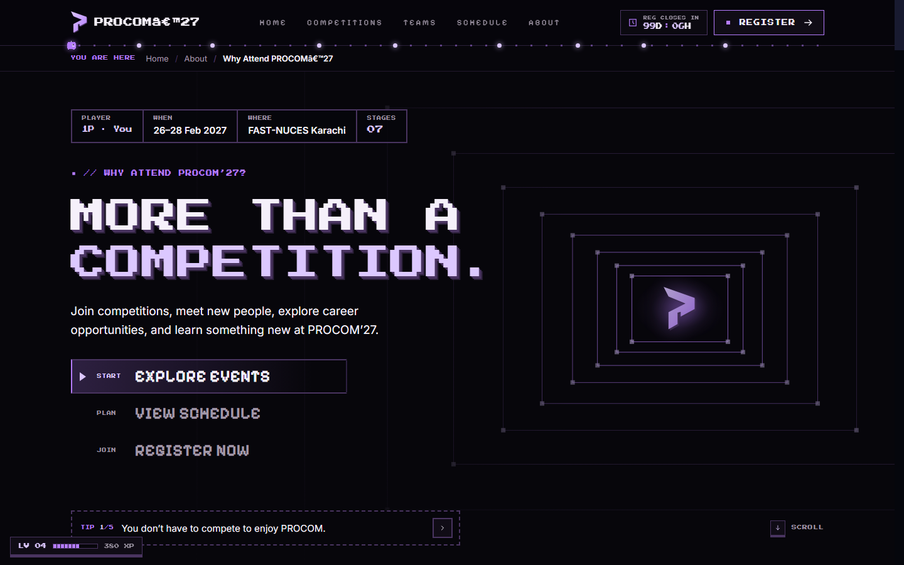
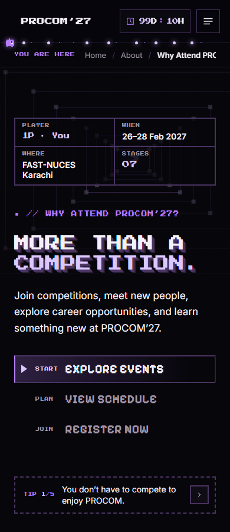
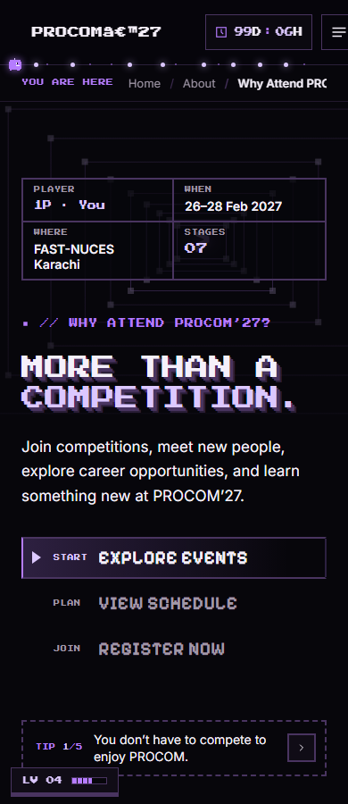

# Why Attend React conversion

Source: supplied `why-attend (3).html`. The original standalone page was rendered locally and compared against the React implementation. This is a native JSX implementation, with no iframe, HTML injection, runtime HTML parser or legacy-script wrapper.

## Integration

Lazy Wouter route `/why-attend` lives inside the existing app shell and Dino initialization boundary. The reference has a different navbar/footer design, so its chrome is isolated to this route. Existing pages retain their original chrome; the existing footer gains one Why Attend link. Styles and keyframes are scoped to avoid altering other routes. Inter and Pixelify Sans are self-hosted with OFL licenses; existing Press Start 2P is reused. No dependencies were added to package.json. The lockfile was reconciled because upstream declared Wouter without its lockfile entries, causing npm ci to fail.

Components cover the hero/tips, world map, brick breaker/power meter, lobby, career routes, ticket machine, bonus cards, boss battle, personalized haul, reference navigation, XP/sound/coin controls, visual effects, and Bit Runner with a device-local leaderboard. React owns interactive state; animation/physics use cleaned effects and refs.

## Local preview and checks

Run `npm install`, then `npm run dev -- --host 127.0.0.1 --port 3005 --strictPort`; open http://localhost:3005/why-attend. Stop with Ctrl+C.

Run `node --test tests/*.test.mjs`, `npm run lint` and `npm run build`. No TypeScript/type-check script is configured in this JavaScript repository.

Browser suites use only Node built-ins and an isolated Chromium remote-debugging session. Launch Chrome with `--remote-debugging-port=9225` and a dedicated `--user-data-dir`. Set `CDP_URL=http://127.0.0.1:9225` and `SITE_URL=http://127.0.0.1:4176` (or your development server), then run each script in tests/browser: whyAttendEarly.mjs, whyAttend.mjs, whyAttendChrome.mjs. Tests navigate the first tab in that isolated profile and exercise local storage; do not target a personal browsing session.

## Visual verification

At viewport widths 1920, 1440, 1024, 768, 390, 375 and 320, measured section positions, widths, heights, heading typography and total page height matched the standalone reference after correcting reset-related heading margins and the viewport scrollbar width. Neither implementation had horizontal overflow. The saved measurements are in layout-comparison.json. Reduced motion freezes decorative animation for repeatable layout captures; normal-motion behavior is separately covered by browser interaction checks. These measurements do not assert every animated frame is pixel-identical.

Desktop and mobile reference/React viewport screenshots are included alongside this report. Browser-native scrollbars, persisted XP/credits, countdown values and timing-dependent decorative states can differ. Viewports are emulated Chromium; physical-device frame rates and other browser engines were not measured.

## Missing external integrations

The reference event catalogue, sessions, dates and deadline are proposed demo data and remain unchanged for visual fidelity. They are not asserted as confirmed organizer information. Attendee registration, sponsors, Job Fair/Orbit, panels, startup showcase, ambassadors, campus map and legal/contact placeholders that have no current destination show honest notices. No backend routes or fake successful submissions were invented. Team membership is a separate existing action and is not used as attendee registration. Bit Runner scores remain on the current device, as in the reference; no shared leaderboard API is claimed.

## Completed verification

All 22 Node tests pass (15 original initialization/collision tests plus seven page logic tests). Lint passes with three existing upstream warnings in AuthContext and PortalModal. Production build passes. All three browser suites passed against the final production build with zero JavaScript exceptions and console API errors, including actual brick collision, full boss lifecycle, ticket animations, header/XP/coin controls, full Bit Runner lifecycle/local scores, existing-route navigation and blocked-storage handling.

| Viewport | Standalone reference | React |
|---|---|---|
| Desktop 1440×900 |  |  |
| Mobile 390×900 |  |  |
